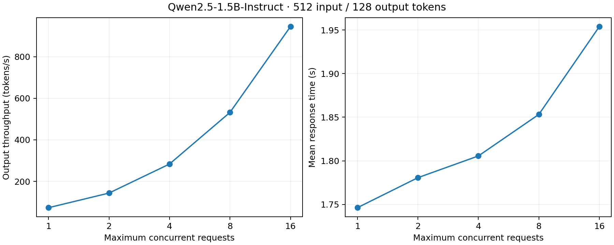

# Experiment 001: concurrency on one L4

Hypothesis: aggregate output throughput increases with concurrency, eventually reaching a bottleneck while individual response latency rises.

## Setup

Run on 2026-10-12 using Runpod's `runpod-torch-v280` template, one NVIDIA L4 (23034 MiB reported memory), 6 vCPUs and 62 GB host RAM. Driver: 595.91.07. Python: 3.12.3. vLLM: 0.31.0. Container disk: 30 GB; no persistent volume. Quoted compute plus disk rate: $0.594/hour.

Model: `Qwen/Qwen2.5-1.5B-Instruct`. Server: context limit 4096, GPU memory utilization 0.8, localhost port 8000. Model revision and full dependency lock were not captured for this initial run.

Client ran on the same Pod through `/v1/completions`, with random synthetic prompts, seed 42, fixed 512 input and 128 output tokens, `--random-range-ratio 0`, and `--ignore-eos`. Each configuration used five warmup requests and 100 measured requests. Request rate was infinite, with a client concurrency cap. Temperature was left at the server/model default. Levels were run in ascending order, once each.

## Observations

| Concurrency | Output tokens/s | Mean response seconds | Median TTFT ms |
|---:|---:|---:|---:|
| 1 | 73.28 | 1.746 | 36.62 |
| 2 | 143.71 | 1.781 | 40.84 |
| 4 | 283.45 | 1.806 | 43.00 |
| 8 | 531.93 | 1.853 | 46.31 |
| 16 | 944.95 | 1.954 | 61.90 |

All 500 measured requests succeeded. Concurrency 16 produced 12.90 times the output throughput of concurrency 1, with 11.94% greater mean response time. No clear throughput plateau is visible in this range.

Response latencies exclude the benchmark client's waiting queue. With an infinite offered request rate, all 100 requests are offered together; many wait for the concurrency cap. These response times therefore do not represent arrival-to-completion latency for the entire burst. Input processing and output generation throughput are distinct: this report uses output throughput.

## Limits and next experiment

One run per configuration gives no estimate of between-run variation. Synthetic prompts, a small model, fixed lengths, default sampling, fixed sweep order and possible prefix-cache reuse limit generalization. We did not record GPU utilization or memory during the sweep, so these data cannot identify the hardware bottleneck or isolate a specific vLLM optimization.

Next: three repeats with explicit temperature 0, alternating sweep order, and levels extended to 32 and 64. Record package versions and GPU details. Use a larger request count for confirmatory high-concurrency runs if short runs show substantial startup/drain effects. Study cache behavior separately; changing the sampling setting means the next series is a new baseline rather than an exact replication.
